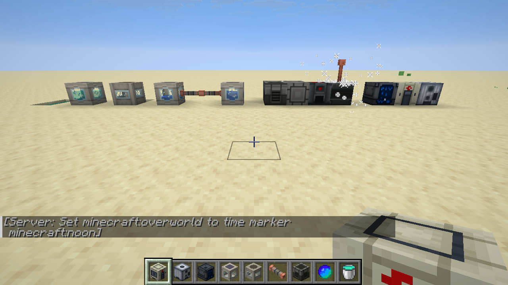
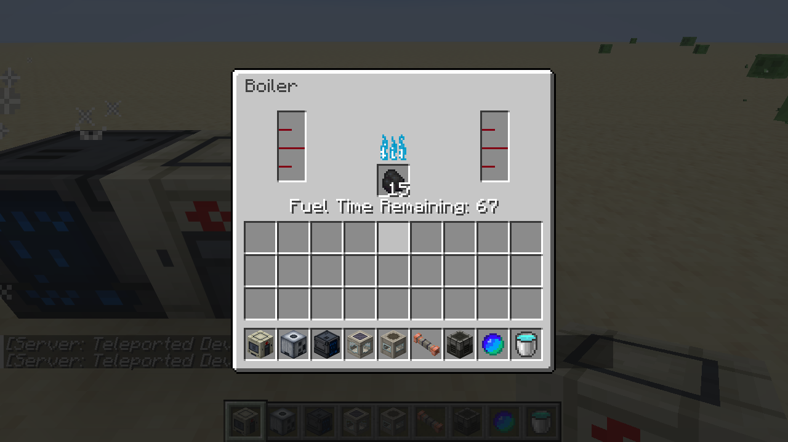
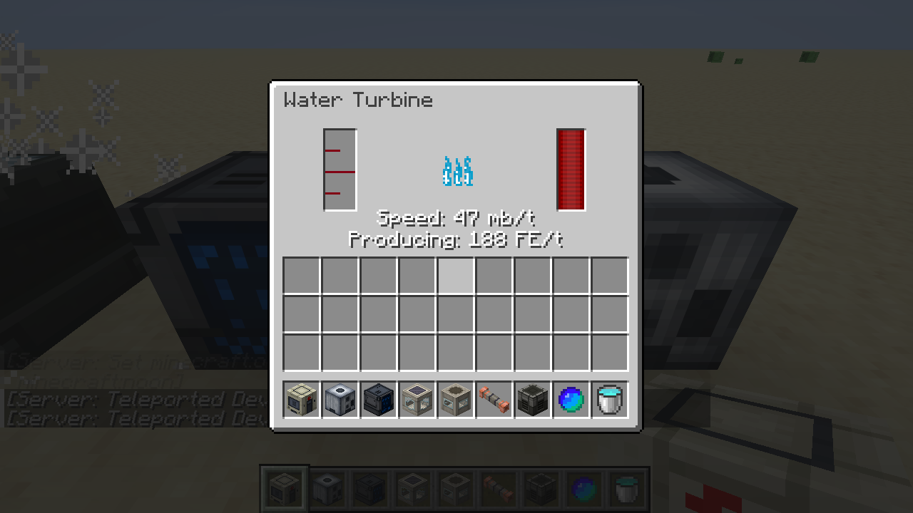
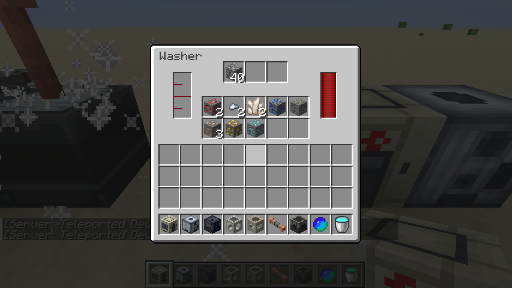
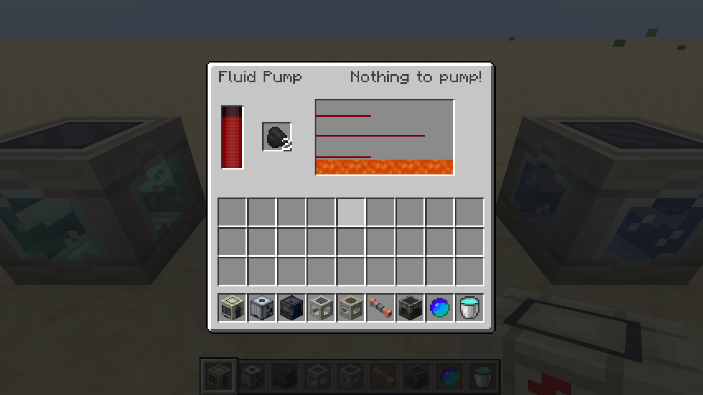
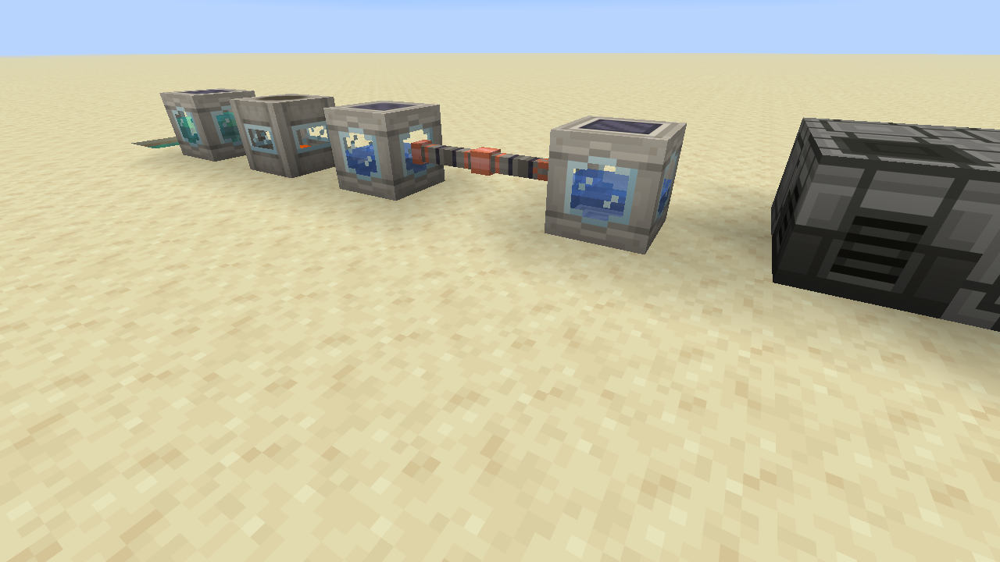
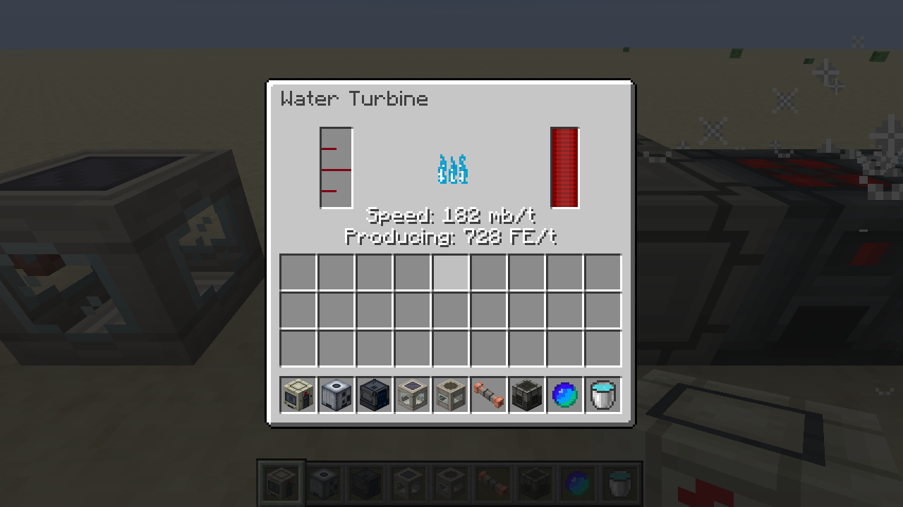

# HydroCraft

A small mod for **Minecraft 26.3** (NeoForge 26.3.0.101) that adds a few different generators. It covers:
- hot water and the machines that make and use it: the boiler, water turbine and multiblock turbine;
- the washer, which turns cobblestone into ores and nuggets;
- a fluid pump, fluid pipes and a fluid tank;
- the (deprecated) lightning generator and lightning dynamo.

The mod ID is `futuregenerators`. The authors are Heather White and clown_95x, and it is licensed BSD 3-Clause.

The original Minecraft 1.20.1 / Forge 47 version is kept on the [`1.20.1`](../../tree/1.20.1) branch.



## The machines

| Block | What it does |
|---|---|
| **Boiler** | Burns furnace fuel to turn water into hot water (100 mB/t). Holds 8,000 mB of water and 16,000 mB of hot water. It pushes hot water into neighbouring blocks. |
| **Water Turbine** | Runs on hot water. It spins up to 200 mB/t over 60 seconds and makes 4 FE per mB. It pushes power into neighbouring blocks. |
| **Turbine Controller + Turbine Casing** | The multiblock turbine. Place a controller with three casings to make a 2x2 square. It reaches 1,000 mB/t over 100 seconds and makes 6 FE per mB. The casings accept hot water and give out power for the controller. |
| **Washer** | Uses hot water (250 mB) and power (1,000 FE) to wash each cobblestone. Each wash has a chance of iron and gold nuggets and ores, quartz, lapis and redstone ore, ender pearls, diamond ore and netherite scrap. |
| **Fluid Pump** | Pumps fluid source blocks from below it, spreading out up to 32 blocks. It runs on burning fuel. By default it pumps water without draining it. |
| **Fluid Pipe** | Moves fluid between anything that holds fluid. Right-click a connection with an empty hand to switch that side between pushing and pulling. Right-click the middle to raise the pipe's priority, or sneak-right-click to lower it. |
| **Fluid Tank** | Holds 100,000 mB of any one fluid and shows it through its windows. Buckets fill and empty it. |
| **Lightning Generator + Lightning Dynamo** (deprecated) | A generator with a lightning rod on top uses lightning charges and power to drive the dynamos beside it, which make 10,000 FE/t each. |

Every number above can be changed in `<world>/syncedconfig/futuregenerators.toml`.

<p>
 
 
</p>

## Building

The build needs Java 25.

```bash
./gradlew build
```

The jar is written to `build/libs/`. To test in game:

```bash
./gradlew runClient
```

The GameTests check every machine in a real server: turbines, boiler, washer, pipes, tank, pump, multiblock turbine and lightning. Run them with:

```bash
./gradlew runGameTestServer
```

## History

### Source recovery

The original project folder was lost. Version 1.5.1 was recovered from the built jar, `HydroCraft-1.5.11.jar`, in four steps:

1. The classes were decompiled with Vineflower 1.12.
2. The obfuscated SRG names were mapped back to Mojang's official names.
3. Assets and data were copied over unchanged.
4. The Forge 1.20.1 Gradle build was recreated.

Comments could not be recovered. That version is on the `1.20.1` branch.

**Fixed since recovery:** the hot water block model pointed at a texture called `hot_water_still` that was never in the jar. It now uses `hot_water.png`, like the fluid itself.

### Port to 26.3 (2.0.0)

|  | 1.20.1 branch | `main` |
|---|---|---|
| Minecraft | 1.20.1 | 26.3 |
| Loader | Forge 47 | NeoForge 26.3.0.101 |
| Java | 17 | 25 |
| Build | ModDevGradle (legacy Forge) | ModDevGradle 2.0.148 |

**What changed:**
- **Storage.** Forge's `FluidTank`, `EnergyStorage`, `ItemStackHandler`, capabilities and `LazyOptional` no longer exist. Machines now use NeoForge's transaction-based transfer API.
  - `util/FluidTank`, `util/FutureGeneratorsEnergyStorage` and `util/ItemStorage` wrap it, with the old direct helpers kept for the machines' own logic.
  - Capabilities are registered in `util/Capabilities`.
  - The boiler's two tanks stay one handler: water goes in, hot water comes out.
- **Fluid pipes** move fluid inside transactions. A pipe now works out exactly how much the network can take before pulling it, so no fluid is lost or made.
  - The original's network delivery subtracted the running total on every step, so it could under-deliver. This is now corrected.
  - Pull sides are read from the block state instead of a copy made when the pipe loaded.
- **Hot water** uses the new data-driven fluid model (still, flowing and overlay textures, plus its aquamarine tint) and keeps its murky fog. The bucket uses NeoForge's `fluid_container` item model.
- **Fuel.** Burn time is now a data component on the item, so the boiler and pump work it out the way the furnace does. Modded fuels still work.
- **GUIs** were moved to the 26.3 GUI API, keeping the same textures and layout. Fluid gauges and the in-world fluid in the tank and pump are drawn from the game's fluid models.
- **Config** is a synced config (`<world>/syncedconfig/futuregenerators.toml`), so the screens read the server's values.
- **Data:**
  - recipes moved to `recipe/` with the new ingredient format;
  - loot tables moved to `loot_table/` with the 26.3 `condition` key;
  - block tags moved to `tags/block/`;
  - every item has a client item definition in `assets/futuregenerators/items/`.
- **Small 26.3 changes:**
  - item drops on breaking now happen in `preRemoveSideEffects`;
  - menus open with `player.openMenu`;
  - the lightning generator accepts any copper lightning rod (oxidised or waxed).
- **GameTests (new):** 10 tests covering every machine.

**Original behaviour kept as it was:**
- The multiblock turbine's GUI shows "Producing" using the single turbine's FE ratio, so it shows less than the multiblock really makes.
- Cobblestone can't be taken back out of the washer's input slots.
- Turbine casings don't push power themselves; only the controller does.

<p>
 
</p>
